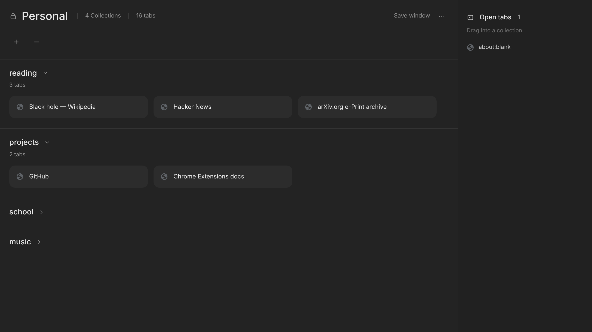

# Stash — Tab Collections

A minimal, dark bookmark manager for [Helium](https://helium.computer) and other Chromium browsers. Save tabs into collapsible collections, drag them around, and open them again in one click.



## Features

- **Collections**: click to open or close, double-click a name to rename it, drag them to reorder
- **Tab cards** with site icons. Click to open; Ctrl/⌘-click or middle-click opens a background tab
- **Edit any card**: change its display name or link, or add notes (notes are searchable)
- **Open tabs panel**: drag your open tabs straight into a collection. The panel can collapse (`\`)
- **Right-click → Save to Stash** on any page or link
- **Save window** saves every open tab as a new collection
- **Themes**: six presets, custom colors and an optional background image with a dim slider
- **New tab page**: Stash replaces the new tab, and links open in place
- **Filter, sort and views** (Compact / Comfortable / List) in Settings (`/` to filter)
- **Undo** for deletes, plus **Export / Import JSON** backups
- **Private**: everything is stored locally in your browser. No accounts, no network requests

## Install

1. Download this repo (**Code → Download ZIP**) and unzip it, or `git clone` it.
2. Open `helium://extensions` (or `chrome://extensions`) and turn on **Developer mode**.
3. Click **Load unpacked** and select the folder.
4. Open a new tab, or click the toolbar icon (**Alt+Shift+S**).

> **Heads up:** your collections are stored inside the extension. Removing the extension deletes them, so use **Settings → Export JSON** first. Keep the folder in the same place, too: loading it from a new location counts as a different extension.

## Keyboard shortcuts

| Key | Action |
| --- | --- |
| `/` | Open Settings and focus the filter |
| `n` | New collection |
| `\` | Collapse or expand the open-tabs panel |
| `Alt+Shift+S` | Open Stash |

## Project layout

```
manifest.json    Extension manifest (MV3)
background.js    Toolbar button and right-click menu
manager.html     The main page (also the new tab page)
manager.css      Styles and theme variables
manager.js       All page logic
icons/           Extension icons
```

There's no build step: edit the files and click reload on the extensions page.

## Contributing

Issues and pull requests are welcome.

## License

[MIT](LICENSE)
